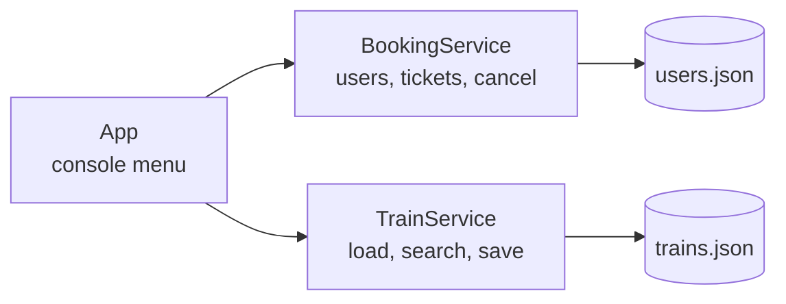

<div align="center">

# 🚆 Train Ticket Booking System

**Sign up. Search. Pick your seat. Travel.**
A console-based railway reservation app in Java, with no database to install and no setup headaches.


</div>

---

## ✨ Why this project?

Booking a train seat looks simple until you build it. You have to keep accounts safe, find trains that actually run from A to B in the right direction, stop two people from taking the same seat, and give the seat back when a ticket is cancelled.

This project does all of that in plain Java, using small JSON files as storage. You can clone it, run it and read the whole codebase in an afternoon.

<!-- Add a screenshot or GIF of the app running here:

-->

## 🎯 What you can do

| | Feature | What it does |
|---|---|---|
| 🔐 | **Sign up and log in** | Passwords are hashed with BCrypt. The plain password is never saved. |
| 🔎 | **Search trains** | Finds trains from a source to a destination. Case-insensitive, and the source must come before the destination on the route. |
| 💺 | **Book a seat** | Choose a train, then pick a row and column from its seat grid. Taken seats can't be booked twice. |
| 🎫 | **View bookings** | See every ticket you hold, with its ID, train number and seat. |
| ❌ | **Cancel a ticket** | Cancel by ticket ID. The seat is released and can be booked again. |
| 💾 | **Remembers everything** | Users, tickets and seat availability survive restarts. |
| 🛡️ | **Hard to break** | Bad menu choices, non-numeric input and out-of-range seats are handled without crashing. |

## 🖥️ A quick look

```
Running train booking system...
1. Signup User
2. Login User
3. FetchBooking
4. Search trains
5. Book a seat
6. Cancel my seat
7. Exit
```

An example session (exact output may differ slightly):

```
> 4
Searching trains..
Enter source ..
bangalore
Enter destination..
pune
Train Id : t123  Train No : 111  Bangalore -> Pune

> 5
Enter train number : 111
Exists
Enter the row you want to select
0
Enter the column you want to select
1
Seat available
Do you want this seat
yes
Booked. Your ticket ID is 3f2b...
```

## 🧩 How it works



- **`App`** only handles input and output.
- **`BookingService`** owns the logged-in user, signup, login, ticket creation and cancellation.
- **`TrainService`** loads trains, searches routes and saves seat changes.
- **Jackson** turns the JSON files into Java objects and back.

Each seat is a number in a grid: `0` is free and `1` is booked. Booking flips a seat to `1` and records a ticket for the user. Cancelling removes the ticket and flips the seat back to `0`.

## 🚀 Getting started

**Prerequisites:** JDK 17 or newer, and IntelliJ IDEA (or any IDE with Gradle support).

```bash
git clone https://github.com/<your-username>/<repo-name>.git
cd <repo-name>
```

1. Open the folder in IntelliJ IDEA and let Gradle finish syncing.
2. Check that `data/users.json` contains `[]` and `data/trains.json` has at least one train (see below).
3. Run `ticket.booking.App`.

**Try this first:** sign up, log in, search `Bangalore` to `Pune`, book a seat, view it with option 3, then cancel it with option 6 and watch the seat come free again.

<details>
<summary><b>📂 Data format (click to expand)</b></summary>

<br>

`data/users.json` starts empty:

```json
[]
```

`data/trains.json` holds the trains. In the seat grid, `0` is free and `1` is booked. Stations are listed in route order:

```json
[
  {
    "trainId": "t123",
    "trainNo": "111",
    "seats": [
      [0, 0, 0, 0],
      [0, 0, 0, 0],
      [0, 0, 0, 0],
      [0, 0, 0, 0]
    ],
    "stationTimes": {},
    "stations": ["Bangalore", "Pune"]
  }
]
```

To add a train, add another object to the list with a unique `trainNo`.

</details>

<details>
<summary><b>🗂️ Project structure (click to expand)</b></summary>

<br>

```
Ticket-Booking/
├── data/
│   ├── users.json
│   └── trains.json
├── src/main/java/ticket/booking/
│   ├── App.java
│   ├── entities/
│   │   ├── User.java
│   │   ├── Train.java
│   │   └── Ticket.java
│   ├── services/
│   │   ├── BookingService.java
│   │   └── TrainService.java
│   └── Util/
│       └── UserServiceUtil.java
└── build.gradle
```

</details>

## 🛠️ Built with

- **Java**: core language
- **Gradle**: build tool, wrapper included
- **[Jackson](https://github.com/FasterXML/jackson)**: JSON reading and writing
- **[jBCrypt](https://www.mindrot.org/projects/jBCrypt/)**: password hashing

## ⚠️ Known limitations

Being upfront about what this version doesn't do yet:

- Seat availability belongs to the train, not to a travel date, so a booked seat is taken for every date.
- The travel date, source and destination on tickets are placeholders.
- There is no duplicate-username check at signup.
- Local JSON files suit a small project, not many simultaneous users.

## 🗺️ Roadmap

- [ ] Seat availability per train per travel date
- [ ] Real travel date and route stored on each ticket
- [ ] Duplicate-username check at signup
- [ ] SQLite instead of JSON files
- [ ] Unit tests for the services

## 🤝 Contributing

Ideas and pull requests are welcome. Open an issue to discuss what you'd like to change, or pick something from the roadmap above.

## 👤 Author

Zoya Shireen Ashraf
GitHub: https://github.com/zoya-ashraf

---

<div align="center">

If this project helped you, consider giving it a ⭐

</div>
